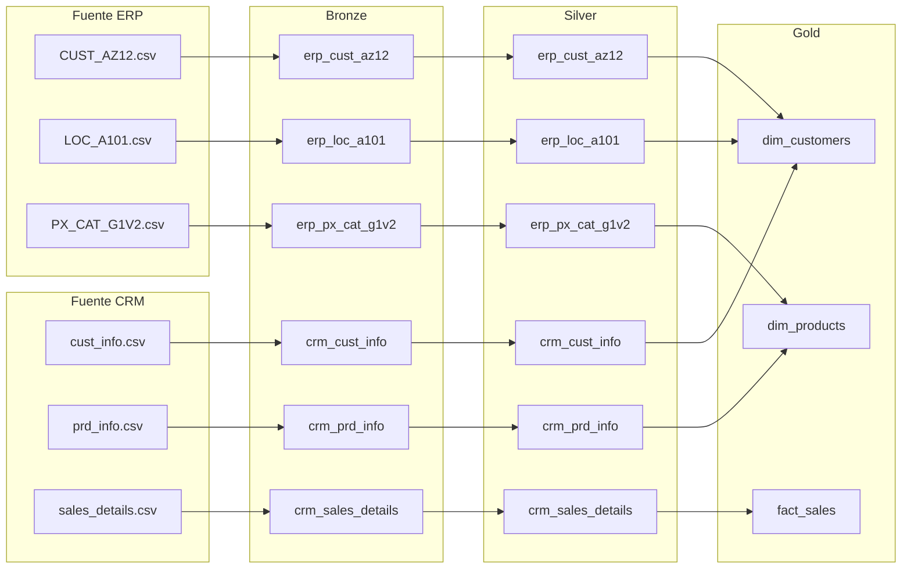
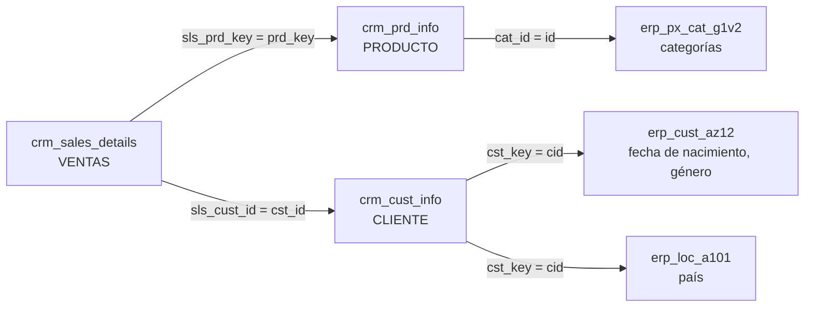

# Arquitectura de datos

## Capas

| | Bronze | Silver | Gold |
|---|---|---|---|
| **Definición** | Datos originales, tal como llegan de las fuentes | Datos limpios y estandarizados | Datos preparados para el negocio |
| **Objetivo** | Trazabilidad y reprocesamiento | Calidad y consistencia | Reportes y análisis |
| **Tipo de objeto** | Tablas | Tablas | Vistas |
| **Carga** | Lote, completa, truncate & insert | Lote, completa, truncate & insert | No aplica |
| **Transformaciones** | Ninguna | Limpieza, estandarización, normalización, columnas derivadas, enriquecimiento | Integración, reglas de negocio, agregaciones |
| **Modelo** | Tal como se recibe | Tal como se recibe | Esquema estrella y vistas de reporte |
| **Proceso** | `bronze.load_bronze(path)` | `silver.load_silver()` | `gold/ddl_gold.sql` |
| **Columnas técnicas** | `dwh_load_date`, `dwh_source_file` | `dwh_create_date` | — |

La implementación usa **una sola base** (`data_warehouse`) con **un esquema
por capa**, que es la segunda alternativa de la clase. Las cargas quedan
registradas en `audit.load_log`.

## Flujo de datos (linaje)

## Integración entre fuentes

Las claves no coinciden tal como vienen; en Silver se ajustan para poder unir:

| Relación | Origen | Ajuste en Silver |
|---|---|---|
| Producto → categoría | `prd_key = 'CO-RF-FR-R92B-58'`, `id = 'CO_RF'` | `cat_id` = primeros 5 caracteres con `-` → `_`; `prd_key` = desde el carácter 7 |
| Venta → producto | `sls_prd_key = 'FR-R92B-58'` | Coincide con el `prd_key` recortado |
| Cliente CRM → ERP fecha de nacimiento | `cst_key = 'AW00011000'`, `cid = 'NASAW00011000'` | Se quita el prefijo `NAS` |
| Cliente CRM → ERP ubicación | `cid = 'AW-00011000'` | Se quitan los guiones |

## Problemas de calidad encontrados y tratamiento

| Tabla | Problema en el origen | Tratamiento en Silver |
|---|---|---|
| crm_cust_info | `cst_id` nulo (4) y 5 `cst_id` duplicados | Se descartan los nulos; se conserva el registro más reciente |
| crm_cust_info | Espacios en nombres; códigos `M`/`S`/`F` | TRIM y valores descriptivos (`Married`, `Single`, `Female`, `Male`, `n/a`) |
| crm_prd_info | `prd_cost` vacío; `prd_line` con espacios | Costo 0; línea descriptiva (`Mountain`, `Road`, `Other Sales`, `Touring`) |
| crm_prd_info | Fecha de fin anterior a la de inicio (200) | Fin = un día antes del inicio de la siguiente versión |
| crm_sales_details | Fechas en 0 o mal formadas (19) | NULL |
| crm_sales_details | Ventas o precios nulos, negativos o que no cuadran (35) | Ventas = cantidad × \|precio\|; precio = ventas / cantidad |
| erp_cust_az12 | Prefijo `NAS`; fechas de nacimiento futuras (16) | Se quita el prefijo; futuras → NULL |
| erp_cust_az12 | Género como `M`, `F`, `Male`, `Female`, vacíos | `Male`, `Female`, `n/a` |
| erp_loc_a101 | Guiones en `cid`; países como `DE`, `US`, `USA`, vacíos | Sin guiones; `Germany`, `United States`, `n/a` |
