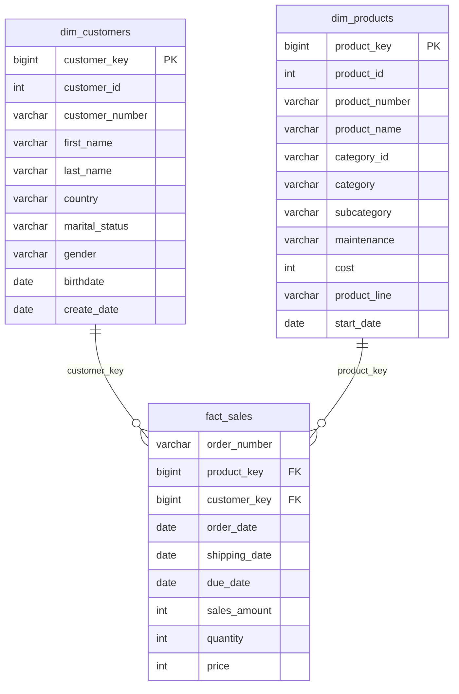

# Modelo de datos – capa Gold (esquema estrella)



- **Grano de `fact_sales`:** una fila por línea de pedido (`order_number` +
  producto).
- **Claves subrogadas:** `customer_key` y `product_key` se generan con
  `ROW_NUMBER()` en las vistas. No dependen de las claves del sistema origen.
- **Regla de negocio:** `sales_amount = quantity × price`.
- **Vista de reporte:** `gold.report_sales_monthly` agrega por mes los
  pedidos, clientes, unidades y monto de ventas.

## Ejemplo de consulta

```sql
SELECT c.country,
       p.category,
       SUM(f.sales_amount) AS total_sales
FROM   gold.fact_sales f
JOIN   gold.dim_customers c ON c.customer_key = f.customer_key
JOIN   gold.dim_products  p ON p.product_key  = f.product_key
GROUP BY c.country, p.category
ORDER BY total_sales DESC;
```
