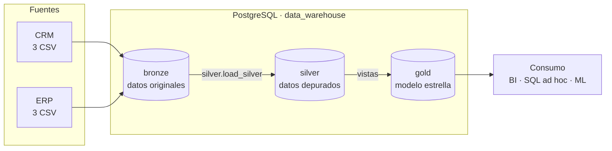

# SQL Data Warehouse (PostgreSQL) – Arquitectura Medallion

Almacén de datos de ventas construido en **PostgreSQL** con la arquitectura
**Medallion** (Bronze → Silver → Gold). Integra dos sistemas de origen, un
**CRM** y un **ERP**, entregados como archivos CSV, en un modelo en estrella
listo para reportes y consultas analíticas.

Curso ISW-623 Bases de Datos Avanzadas – UTN.

## Requisitos del proyecto

| Especificación | Cómo se cumple |
|---|---|
| Fuentes de datos: importar ERP y CRM desde CSV | Capa Bronze, `bronze.load_bronze` / `load_bronze_psql.sql` |
| Calidad: limpiar los datos antes del análisis | Capa Silver, `silver.load_silver` y `04_tests/` |
| Integración: un solo modelo fácil de consultar | Capa Gold, esquema estrella (`dim_customers`, `dim_products`, `fact_sales`) |
| Alcance: solo el conjunto de datos más reciente | Cargas completas (truncate & insert) y productos vigentes en Gold |
| Documentación del modelo | `02_docs/` (arquitectura, flujo, modelo y catálogo de datos) |

## Arquitectura



| Capa | Objeto | Carga | Transformaciones | Modelo |
|---|---|---|---|---|
| **Bronze** | Tablas | Lote, completa (truncate & insert) | Ninguna | Tal como se recibe |
| **Silver** | Tablas | Lote, completa (truncate & insert) | Limpieza, estandarización, normalización, columnas derivadas, enriquecimiento | Tal como se recibe |
| **Gold** | Vistas | No aplica | Integración, reglas de negocio, agregaciones | Esquema estrella |

Más detalle en [02_docs/data_architecture.md](02_docs/data_architecture.md).

## Estructura del repositorio

```
sqldata_wh_srh/
├── 00_setup/            Guía de instalación y ejecución.
├── 01_datasets/         Los seis archivos de origen.
│   ├── source_crm/      cust_info, prd_info, sales_details.
│   └── source_erp/      CUST_AZ12, LOC_A101, PX_CAT_G1V2.
├── 02_docs/             Arquitectura, flujo, integración, modelo, catálogo y convenciones.
├── 03_scripts/
│   ├── init_database.sql    Crea la base y los esquemas. Se ejecuta primero.
│   ├── run_full_etl.sql     Crea los objetos y ejecuta Bronze → Silver → Gold.
│   ├── bronze/              DDL, procedimiento load_bronze y carga con \copy.
│   ├── silver/              DDL y procedimiento load_silver.
│   └── gold/                Vistas del modelo en estrella.
└── 04_tests/            Revisiones de calidad de Silver y Gold.
```

## Ejecución rápida

Desde la raíz del repositorio, con `psql` en el PATH:

```bash
psql -U postgres -d postgres       -f 03_scripts/init_database.sql
psql -U postgres -d data_warehouse -f 03_scripts/run_full_etl.sql
psql -U postgres -d data_warehouse -f 04_tests/quality_checks_silver.sql
psql -U postgres -d data_warehouse -f 04_tests/quality_checks_gold.sql
```

La guía completa, incluida la ejecución desde pgAdmin, está en
[00_setup/README.md](00_setup/README.md).

## Resultado de la carga

| Objeto | Filas |
|---|---|
| `gold.dim_customers` | 18 484 |
| `gold.dim_products` | 295 (productos vigentes) |
| `gold.fact_sales` | 60 398 |

## Convenciones

Nombres en inglés y `snake_case`; tablas Bronze/Silver como
`<sistema>_<entidad>`, Gold como `dim_` / `fact_` / `report_`, claves
subrogadas con `_key`, columnas técnicas con `dwh_` y procedimientos
`load_<capa>`. Ver [02_docs/naming_conventions.md](02_docs/naming_conventions.md).
